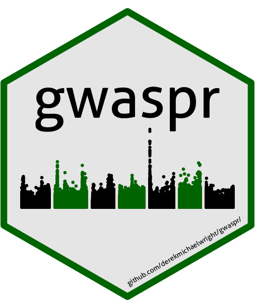
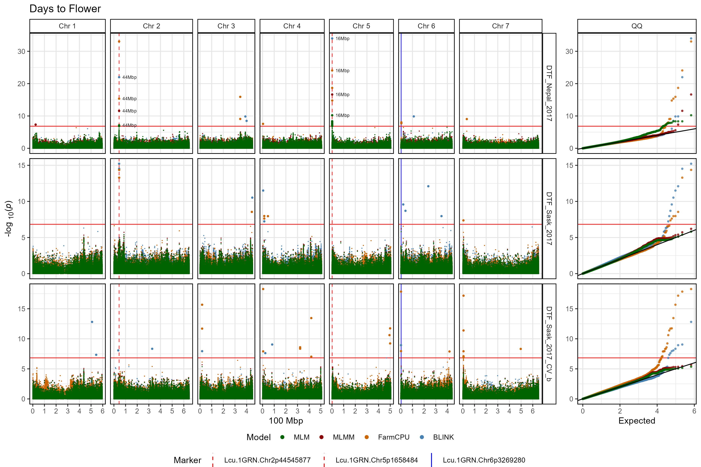
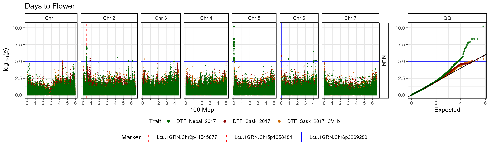
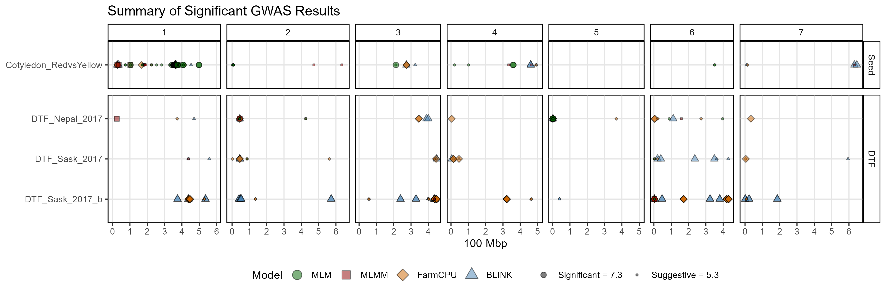
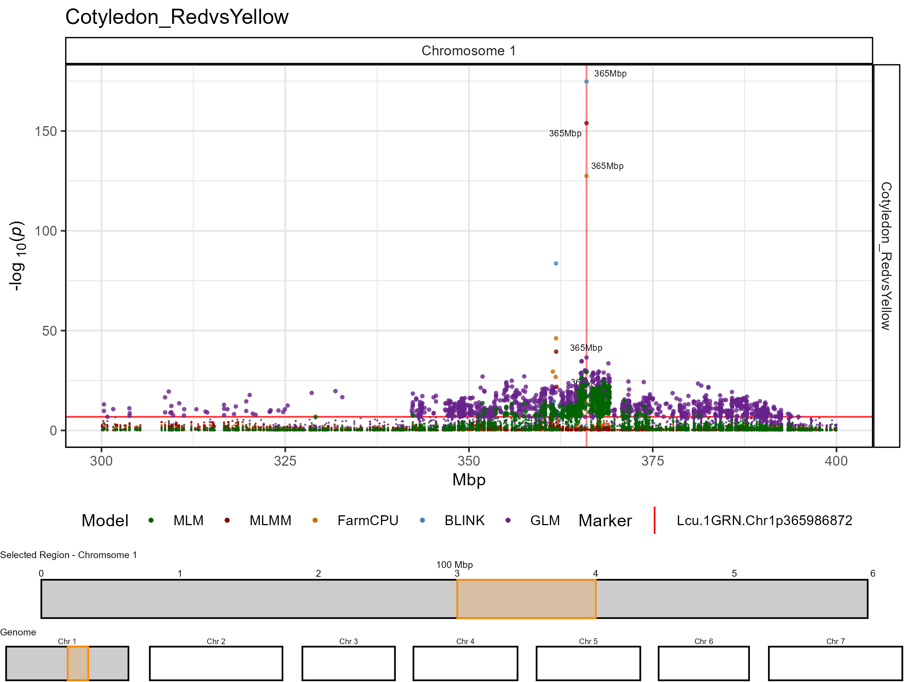
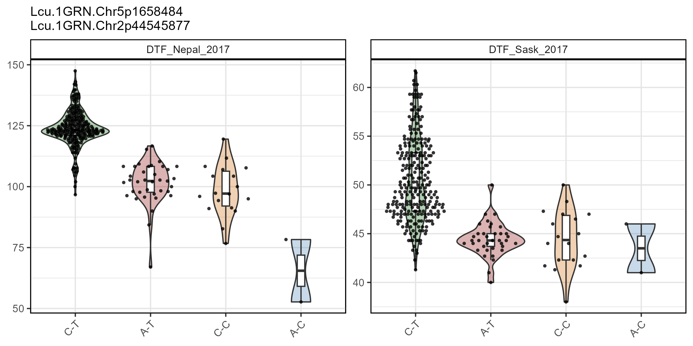
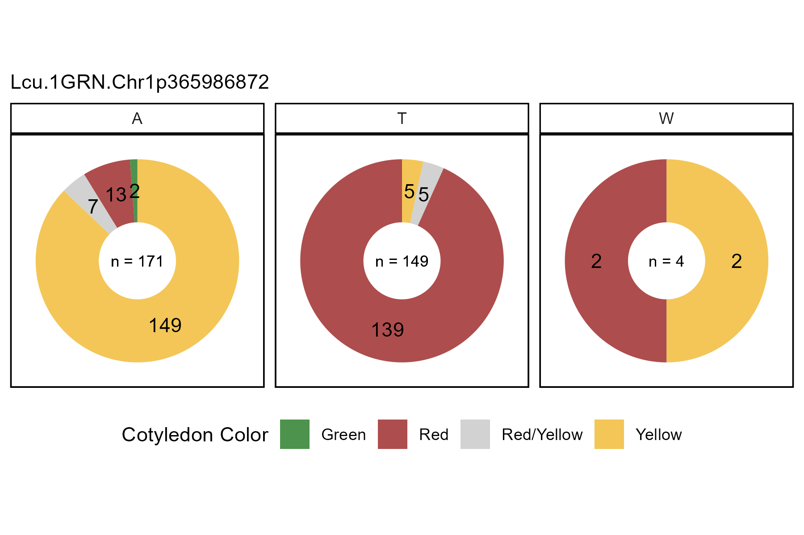
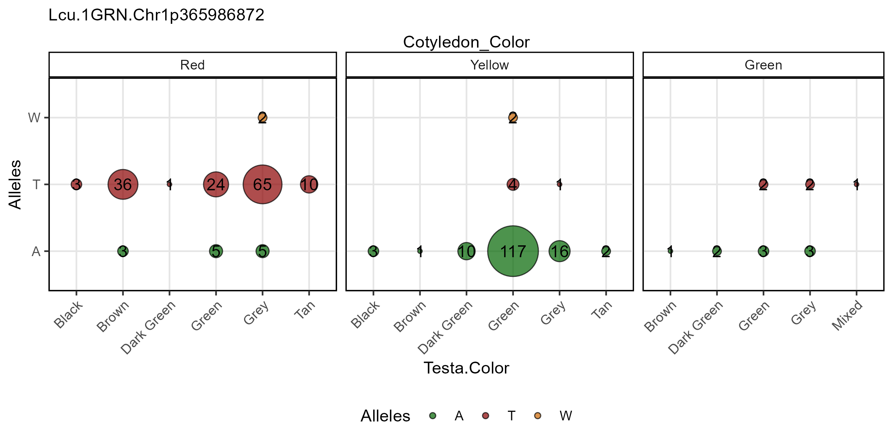
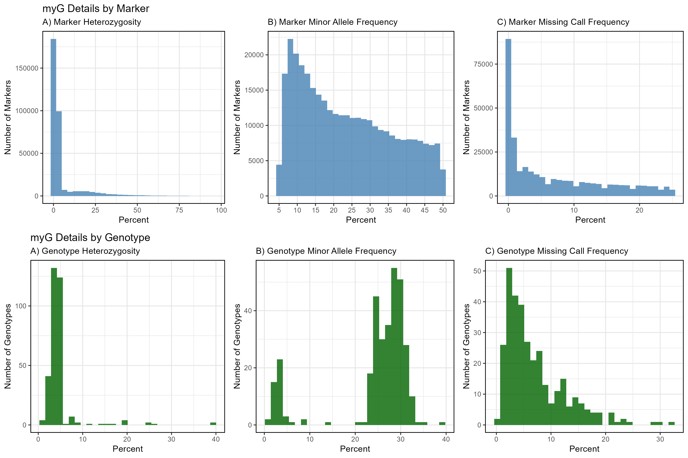
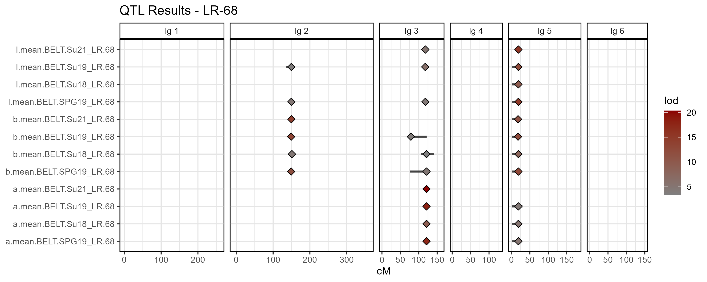

```{r setup, include = FALSE}
knitr::opts_chunk$set(message = F, warning = F)
```

# gwaspr 

`gwaspr`: an `R` package for plotting GWAS results from the `GAPIT` package

---

# Instal `gwaspr`

```{r eval = F}
devtools::install_github("derekmichaelwright/gwaspr")
```

# Load `gwaspr`

```{r}
library(gwaspr)
```

---

# GWAS with `GAPIT`

`GAPIT`: an `R` package for performing Genome Wide Association Studies (GWAS)

> - **GAPIT Website**: [https://www.maizegenetics.net/gapit](https://www.maizegenetics.net/gapit){target="_blank"}
> - **GAPIT github**: [https://github.com/jiabowang/GAPIT](https://github.com/jiabowang/GAPIT){target="_blank"}

```{r eval = F}
devtools::install_github("jiabowang/GAPIT")
```

```{r eval = F}
library(GAPIT)
```

---

# `gwaspr` Github

- **github link**: [https://github.com/derekmichaelwright/gwaspr/](https://github.com/derekmichaelwright/gwaspr/){target="_blank"}

---

# `gwapsr` Tutorial

- **dblogr GWAS Tutorial**: [https://derekmichaelwright.github.io/dblogr/academic/gwas_tutorial/](https://derekmichaelwright.github.io/dblogr/academic/gwas_tutorial/){target="_blank"}
- [Phenotype data (gwaspr_myY.csv)](vignettes/gwaspr_myY.csv)
- [Covariate data (gwaspr_myCV.csv)](vignettes/gwaspr_myCV.csv)
- [Genotype data (gwaspr_myG_hmp.zip)](vignettes/gwaspr_myG_hmp.zip)

---

# Package Dependancies

`tidyverse`, `ggpubr`, `ggbeeswarm`, `ggrepel`, `ggtext`, `plotly`, `htmlwidgets`

---

# Example plots

## gg_Manhattan()





## gg_GWAS_Summary()



## gg_Manhattan_Zoom



## gg_Marker_Box()



## gg_Marker_Pie()



## gg_Marker_Bubble()



## gg_myG_Details()



## gg_LD_Heatmap()


## gg_QTL_Summary()



---


