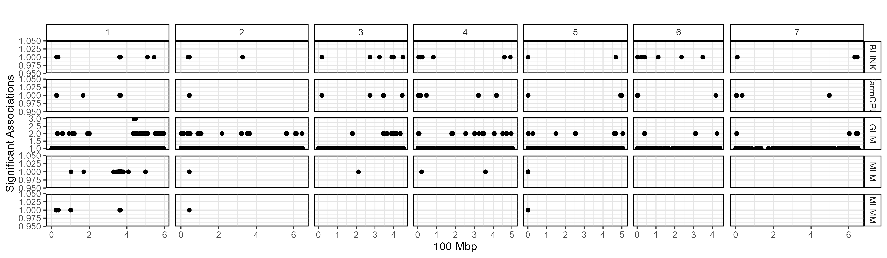

# gg_GWAS_Hits()

``` r

library(gwaspr)
```

The function
[`gg_GWAS_Hits()`](https://derekmichaelwright.github.io/gwaspr/reference/gg_GWAS_Hits.md)
creates summary plots showing significant association from your GWAS
analyses.

``` r

# Plot
mp <- gg_GWAS_Hits(
  folder = "GWAS_Results/" )
# Save
ggsave("figures/gg_GWAS_Hits_01.png", mp, width = 12, height = 3.5)
```


