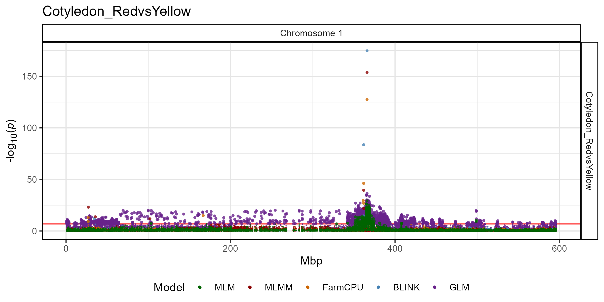
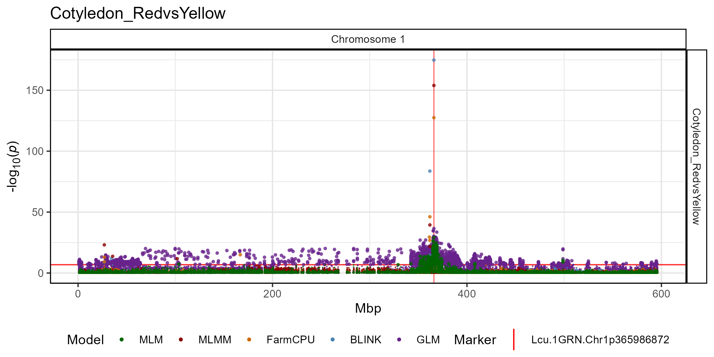
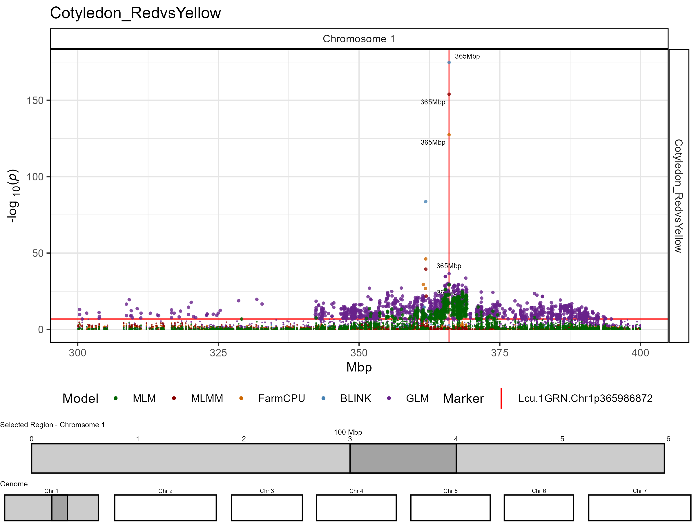
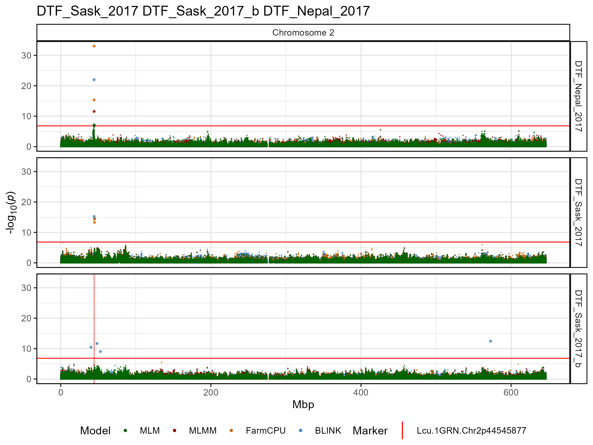
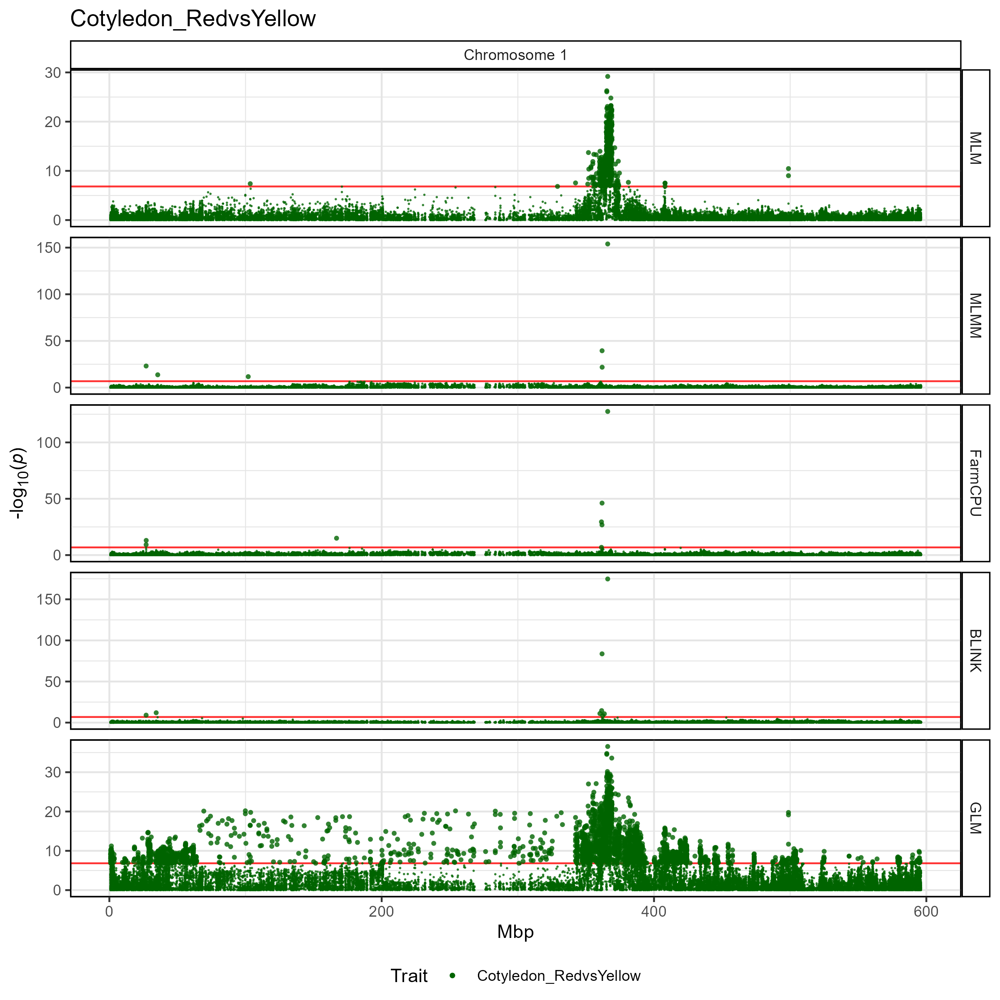
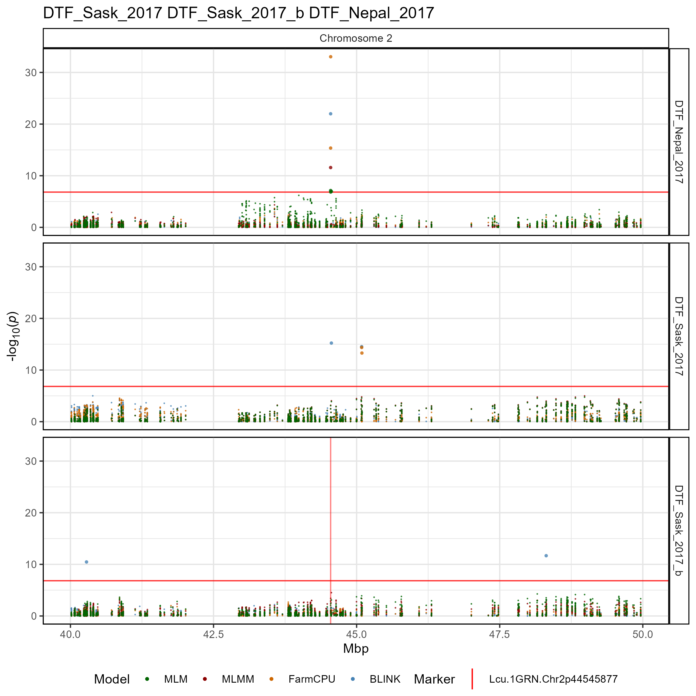

# gg_Manhattan_Zoom()

``` r

library(gwaspr)
```

Due to the large size of most genomes, small shifts in the x-axis on a
standard manhattan plot can result in large distances.

The function
[`gg_Manhattan_Zoom()`](https://derekmichaelwright.github.io/gwaspr/reference/gg_Manhattan_Zoom.md)
creates manhattan plots from GAPIT GWAS results zoomed into a specific
region on a chromosome.

Specifying a `folder`, `traits` and a `chr` (defaults to 1 if not
specified) is all that is needed to create zoomed in manhattan plots.

------------------------------------------------------------------------

## Single trait

``` r

# Plot
mp <- gg_Manhattan_Zoom(
  # Specify a folder with GWAS results
  folder = "GWAS_Results/", 
  # Select traits to plot
  traits = "Cotyledon_RedvsYellow", 
  # Plot just Chromosome 1
  chr = 1 )
# Save
ggsave("figures/gg_Manhattan_Zoom_01_1.png", 
       mp, width = 8, height = 4, bg = "white" )
```



------------------------------------------------------------------------

## All Options

``` r

# Prep data
traits <- "Cotyledon_RedvsYellow"
markers <- "Lcu.1GRN.Chr1p365986872"
vlines <- markers
# Plot
mp <- gg_Manhattan_Zoom(
  folder = "GWAS_Results/", 
  traits = traits, 
  chr = 1,
  pos1 = NULL, pos2 = NULL,
  title = paste(traits, collapse = " "),
  addGenome = F,
  threshold = NULL,
  sug.threshold = NULL,
  markers = NULL,
  labels = markers,
  vlines = markers,
  vline.colors = rep("red", length(vlines)),
  vline.types = rep(1, length(vlines)),
  vline.legend = T,
  facet.model = F,
  pmax = NULL,
  models =  c("MLM", "MLMM", "FarmCPU", "BLINK",  "GLM", "CMLM", "SUPER"),
  model.colors = c("darkgreen", "darkred", "darkorange3", "steelblue", "darkorchid4", "blue2", "magenta3"),
  trait.colors = gwaspr_Colors,
  sig.color = "black",
  legend.rows = 1,
  legend.box = "horizontal",
  point.sizes = c(0.3,1,0.75),
  plotHBPvalues = F,
  skyline = "NYC" )
# Save
ggsave("figures/gg_Manhattan_Zoom_01_2.png", 
       mp, width = 8, height = 4, bg = "white" )
```



------------------------------------------------------------------------

## Zoomed in

Any Region within a chromosome can be plotted by specifying `pos1` and
`pos2`. Additionally, the genome can be added with `addGenome = T`

``` r

# Plot
mp <- gg_Manhattan_Zoom(
  # Specify a folder with GWAS results
  folder = "GWAS_Results/", 
  # Select a trait to plot
  traits = "Cotyledon_RedvsYellow", 
  # Plot just Chromosome 1
  chr = 1,
  pos1 = 300000000,
  pos2 = 400000000,
  # Highlight specific markers
  markers = "Lcu.1GRN.Chr1p365986872",
  # Create alt labels for the markers
  labels = "365Mbp",
  # Specify Color for each marker vline
  vline.colors = "red",
  # Should models be facetted
  addGenome = T )
# Save
ggsave("figures/gg_Manhattan_Zoom_01_3.png",
       mp, width = 8, height = 6, bg = "white" )
```



------------------------------------------------------------------------

## Multiple traits

``` r

# Plot
mp <- gg_Manhattan_Zoom(
  # Specify a folder with GWAS results
  folder = "GWAS_Results/",
  # Select traits to plot
  traits = c("DTF_Sask_2017","DTF_Sask_2017_b","DTF_Nepal_2017"),
  # Plot just Chromosome 2
  chr = 2,
  # Highlight specific markers
  vlines = "Lcu.1GRN.Chr2p44545877",
  # Plot only certain GWAS models
  models = c("MLM", "MLMM", "FarmCPU", "BLINK") ) 
# Save
ggsave("figures/gg_Manhattan_Zoom_02_1.png", 
       mp, width = 8, height = 6 )
```



------------------------------------------------------------------------

## Facet by model

The default for
[`gg_Manhattan_Zoom()`](https://derekmichaelwright.github.io/gwaspr/reference/gg_Manhattan_Zoom.md)
is to set `facet.model = F` and plot all GWAS models together. However,
if `facet.model = T`, then the different GWAS models can be separated.

``` r

# Plot
mp <- gg_Manhattan_Zoom(
  # Specify a folder with GWAS results
  folder = "GWAS_Results/", 
  # Select traits to plot
  traits = "Cotyledon_RedvsYellow", 
  # Plot just Chromosome 1
  chr = 1,
  # Should models be facetted
  facet.model = T )
# Save
ggsave("figures/gg_Manhattan_Zoom_03_1.png", 
       mp, width = 8, height = 8, bg = "white" )
```



------------------------------------------------------------------------

### Multiple traits

``` r

# Plot
mp <- gg_Manhattan_Zoom(
  # Specify a folder with GWAS results
  folder = "GWAS_Results/",
  # Select traits to plot
  traits = c("DTF_Sask_2017", "DTF_Sask_2017_b", "DTF_Nepal_2017"),
  # Highlight specific markers
  vlines = "Lcu.1GRN.Chr2p44545877",
  # Plot just Chromosome 2
  chr = 2, #pos1 = 40000000, pos2 = 50000000,
  # Plot only certain GWAS models
  models =  c("MLM", "MLMM", "FarmCPU", "BLINK"),
  # Should models be facetted
  facet.model = T ) 
# Save
ggsave("figures/gg_Manhattan_Zoom_03_2.png", 
       mp, width = 8, height = 8 )
```



------------------------------------------------------------------------

## Customized plot

``` r

# Plot
mp <- gg_Manhattan_Zoom(
  # Specify a folder with GWAS results
  folder = "GWAS_Results/",
  # Select traits to plot
  traits = c("DTF_Sask_2017", "DTF_Sask_2017_b", "DTF_Nepal_2017"),
  # Highlight specific markers
  vlines = "Lcu.1GRN.Chr2p44545877",
  # Plot just Chromosome 2
  chr = 2, pos1 = 40000000, pos2 = 50000000,
  # Plot only certain GWAS models
  models =  c("MLM", "MLMM", "FarmCPU", "BLINK") ) 
# Save
ggsave("figures/gg_Manhattan_Zoom_03_2.png", 
       mp, width = 8, height = 8 )
```


### Plotly

Make it an interactive plot with the following code

``` r

gg_plotly(mp, filename = "figures/gg_Manhattan_Zoom_03_2.html")
```

<https://derekmichaelwright.github.io/gwaspr/vignettes/figures/gg_Manhattan_Zoom_03_2.html>
