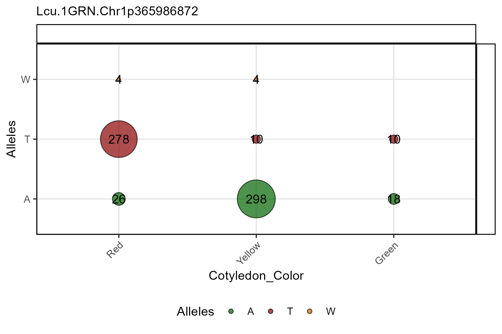
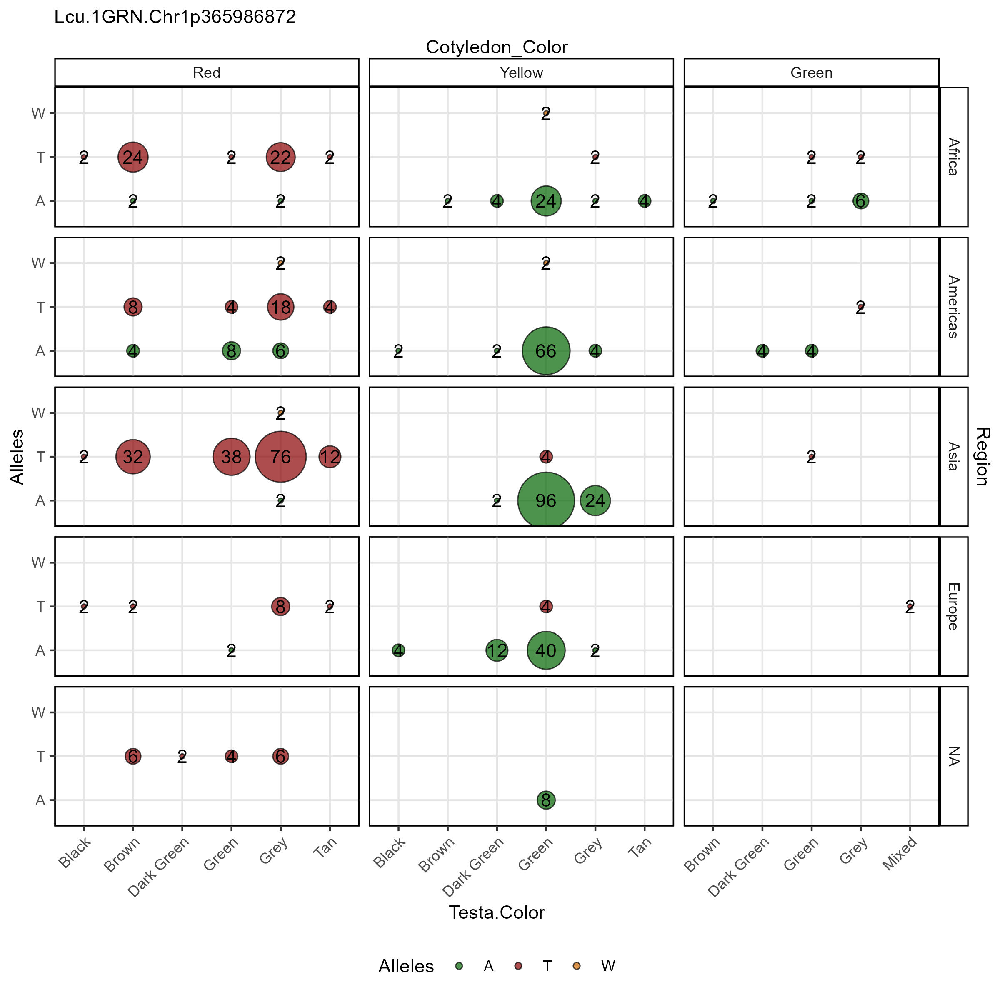

# gg_Marker_Bubble()

``` r

library(gwaspr)
```

The function
[`gg_Marker_Bubble()`](https://derekmichaelwright.github.io/gwaspr/reference/gg_Marker_Bubble.md)
creates marker plots with your `myY` and `myG` GWAS input files.

## Load data

> Note: `header = T`

``` r

# Load genotype file (note: header = T)
myG <- read.csv("gwaspr_myG_hmp.csv", header = T)
```

``` r

# Load phenotype file
myY <- read.csv("gwaspr_myY.csv")
# Convert our nominal trait from numeric to factor.
myY <- myY %>% 
  mutate(Cotyledon_Color = mv(Cotyledon_RedvsYellow, c(1, 0, NA), c("Red", "Yellow", "Green")),
         Cotyledon_Color = factor(Cotyledon_Color, levels = c("Red", "Yellow", "Green")))
```

``` r

myCV <- read.csv("gwaspr_myCV.csv")
```

``` r

myY <- myY %>% left_join(myCV, by = "Name")
```

``` r

myY[1:10,]
```

    ##                 Name DTF_Sask_2017 DTF_Nepal_2017 Cotyledon_RedvsYellow
    ## 1    CDC_Asterix_AGL          54.7          128.0                     0
    ## 2      CDC_Rosie_AGL          59.0          123.3                     1
    ## 3       X3156.11_AGL          60.7          125.3                     1
    ## 4  CDC_Greenstar_AGL          56.7          121.0                     0
    ## 5     CDC_Cherie_AGL          54.3          125.3                     1
    ## 6     CDC_Glamis_AGL          59.0          123.0                     0
    ## 7       CDC_Gold_AGL          54.0          125.3                     0
    ## 8       CDC_Imax_AGL          53.0          128.7                     1
    ## 9    CDC_Impower_AGL          57.0          123.3                     0
    ## 10      CDC_KR.1_AGL          57.0          121.7                     1
    ##    Cotyledon_Color Entry            a             b             c Origin
    ## 1           Yellow     1  0.007269310 -1.201707e-03 -0.0003173782 Canada
    ## 2              Red     2  0.020925213 -1.752062e-03 -0.0015340225 Canada
    ## 3              Red     3  0.011019354 -1.114926e-03 -0.0006771650 Canada
    ## 4           Yellow     4 -0.007194842 -5.607040e-05  0.0009439957 Canada
    ## 5              Red     5  0.001167160 -7.040853e-04  0.0002219715 Canada
    ## 6           Yellow     6  0.011720647 -1.234765e-03 -0.0007444896 Canada
    ## 7           Yellow     7 -0.009512816 -9.853332e-05  0.0011238201 Canada
    ## 8              Red     8  0.005803829 -1.210779e-03 -0.0001005016 Canada
    ## 9           Yellow     9  0.012545983 -1.396606e-03 -0.0008239436 Canada
    ## 10             Red    10  0.008388588 -7.986330e-04 -0.0006355631 Canada
    ##      Region Testa.Color DTF.Culter       P1 P2 P3 P4       P5      P6       P7
    ## 1  Americas       Green          7 0.000000  0  0  0 0.000000 0.00000 0.048938
    ## 2  Americas        Grey          8 0.000000  0  0  0 0.000000 0.00000 0.000000
    ## 3  Americas        Grey          8 0.000000  0  0  0 0.000000 0.00000 0.169824
    ## 4  Americas       Green          7 0.000000  0  0  0 0.000000 0.00000 0.258426
    ## 5  Americas        Grey          7 0.000000  0  0  0 0.090267 0.00000 0.111004
    ## 6  Americas       Green          8 0.000000  0  0  0 0.003119 0.00000 0.182356
    ## 7  Americas       Green          7 0.088823  0  0  0 0.000000 0.01545 0.116633
    ## 8  Americas        Grey          7 0.000000  0  0  0 0.118120 0.00000 0.202169
    ## 9  Americas       Green          7 0.000000  0  0  0 0.000000 0.00000 0.220574
    ## 10 Americas       Brown          3 0.000000  0  0  0 0.030931 0.00000 0.284686
    ##          P8 STR_Group
    ## 1  0.951062        P8
    ## 2  1.000000        P8
    ## 3  0.830176        P8
    ## 4  0.741574       Mix
    ## 5  0.798729       Mix
    ## 6  0.814525        P8
    ## 7  0.779093       Mix
    ## 8  0.679711       Mix
    ## 9  0.779426       Mix
    ## 10 0.684383       Mix

------------------------------------------------------------------------

## Single marker, single trait

Specifying a `trait.x` and `markers` along with your genotype and
phenotype data as `xG` and `xY` is needed to create marker plots.

``` r

# Plot
mp <- gg_Marker_Bubble(
  # Genotype data
  xG = myG, 
  # Phenotype data
  xY = myY,
  # Select traits to plot
  trait.x = "Cotyledon_Color",
  # Select markers to plot
  markers = "Lcu.1GRN.Chr1p365986872" )
# Save
ggsave("figures/gg_Marker_Bubble_01.png", 
       mp, width = 6, height = 4 )
```



------------------------------------------------------------------------

## All options

`gg_Marker_Bubbles()` contains a number of different options for
customizing the marker plots.

Note: one of `trait.x`, `trait.y`, `facet.rows`, `facet.cols` must be
set to `= "Alleles"`.

``` r

# Prep data
markers <- c("Lcu.1GRN.Chr1p365986872")
# Plot
mp <- gg_Marker_Bubble(
  xG = myG, 
  xY = myY,
  trait.x = "Cotyledon_Color",
  markers = markers,
  trait.y = "Alleles",
  facet.rows = NULL,
  facet.cols = NULL,
  marker.colors = gwaspr_Colors,
  remove.hets = F,
  remove.N = T,
  legend.pos = "bottom",
  legend.rows = 1,
  title = NULL,
  subtitle = paste(markers, collapse = "\n") )
# Save
ggsave("figures/gg_Marker_Bubble_02.png", 
       mp, width = 6, height = 4 )
```


------------------------------------------------------------------------

## Facet grouping

### Column facetting

``` r

# Plot
mp <- gg_Marker_Bubble(
  # Genotype data
  xG = myG, 
  # Phenotype data
  xY = myY,
  # Select traits to plot
  trait.x = "Testa.Color",
  # Select markers to plot
  markers = "Lcu.1GRN.Chr1p365986872",
  # Select a trait for col facetting
  facet.cols = "Cotyledon_Color" )
# Save
ggsave("figures/gg_Marker_Bubble_03.png", 
       mp, width = 8, height = 4 )
```


------------------------------------------------------------------------

### Row facetting

``` r

# Plot
mp <- gg_Marker_Bubble(
  # Genotype data
  xG = myG, 
  # Phenotype data
  xY = myY,
  # Select traits to plot
  trait.x = "Testa.Color",
  # Select markers to plot
  markers = "Lcu.1GRN.Chr1p365986872",
  # Select a trait for col facetting
  facet.cols = "Cotyledon_Color",
  # Select a trait for row facetting
  facet.rows = "Region" )
# Save
ggsave("figures/gg_Marker_Bubble_04.png", 
       mp, width = 8, height = 8 )
```


