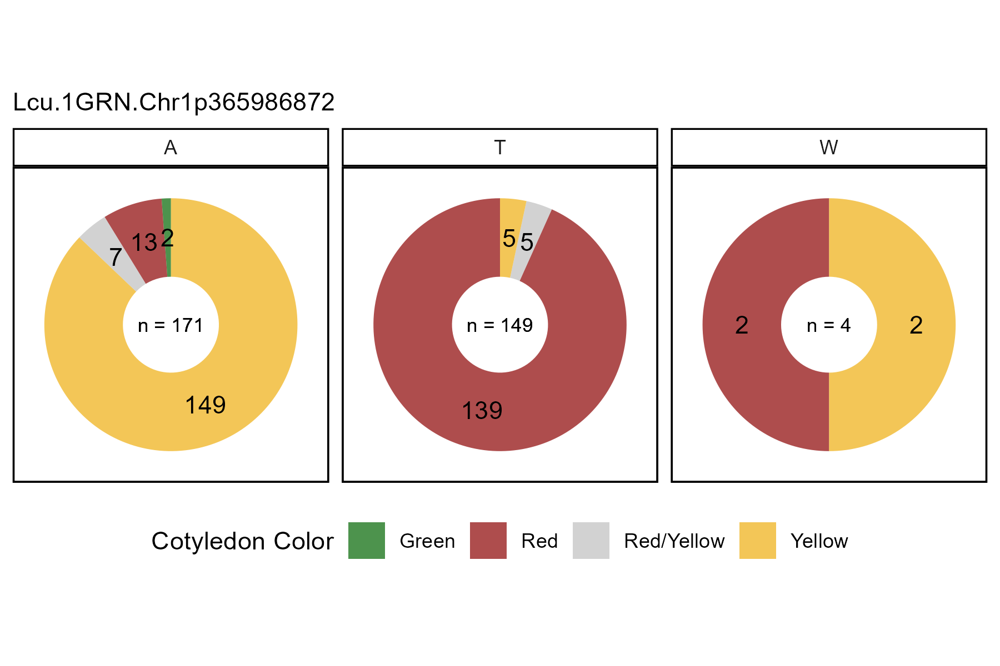
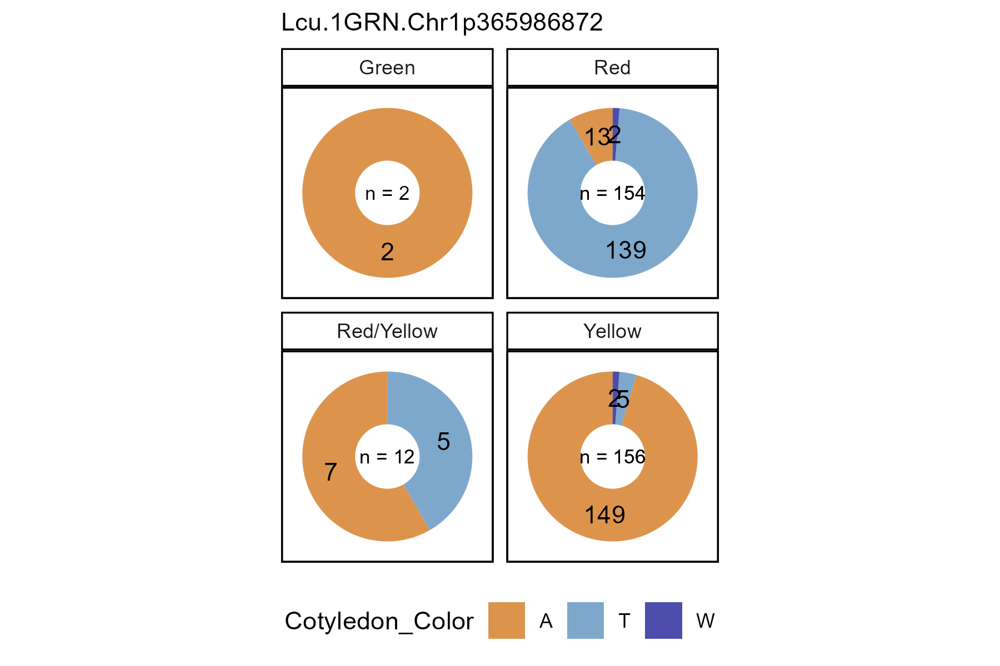

# gg_Marker_Pie()

``` r

library(gwaspr)
```

The function
[`gg_Marker_Pie()`](https://derekmichaelwright.github.io/gwaspr/reference/gg_Marker_Pie.md)
creates marker plots with your `myY` and `myG` GWAS input files.

## Load data

> Note: `header = T`

``` r

# Load genotype file (note: header = T)
myG <- read.csv("Data/gwaspr_myG_hmp.csv", header = T)
```

``` r

# Load phenotype file
myY <- read.csv("Data/gwaspr_myY.csv")
```

------------------------------------------------------------------------

## Single marker, single trait

Specifying a `trait` and `markers` along with your genotype and
phenotype data as `xG` and `xY` is needed to create marker plots.

``` r

# Plot 
mp <- gg_Marker_Pie(
  # Genotype data
  xG = myG, 
  # Phenotype data
  xY = myY,
  # Select traits to plot
  trait = "Cotyledon_Color",
  # Select markers to plot
  markers = "Lcu.1GRN.Chr1p365986872",
  # Select marker colors
  marker.colors = c("darkgreen", "darkred", "grey", "darkgoldenrod2") )
# Save
ggsave("figures/gg_Marker_Pie_01.png", 
       mp, width = 6, height = 4 )
```


------------------------------------------------------------------------

## All options

[`gg_Marker_Bar()`](https://derekmichaelwright.github.io/gwaspr/reference/gg_Marker_Bar.md)
contains a number of different options for customizing the marker plots.

``` r

# Prep data
markers <- c("Lcu.1GRN.Chr1p365986872")
# Plot 
mp <- gg_Marker_Pie(
  xG = myG, 
  xY = myY,
  trait = "Cotyledon_Color",
  markers = markers,
  marker.colors = c("darkgreen", "darkred", "grey", "darkgoldenrod2"),
  trait.label = "Cotyledon Color",
  trait.levels = NULL,
  remove.hets = F,
  remove.N = T,
  title = NULL,
  subtitle = paste(markers, collapse = "\n"),
  ncol = NULL,
  legend.rows = 1,
  removeHets = T,
  groupByTrait = F )
# Save
ggsave("figures/gg_Marker_Pie_02.png", 
       mp, width = 6, height = 4 )
```



------------------------------------------------------------------------

## Switch facetting

Set `groupByTrait = T` to switch from facetting by markers to facetting
by trait.

``` r

# Plot 
mp <- gg_Marker_Pie(
  # Genotype data
  xG = myG, 
  # Phenotype data
  xY = myY,
  # Select traits to plot
  trait = "Cotyledon_Color",
  # Select markers to plot
  markers = "Lcu.1GRN.Chr1p365986872",
  # Select marker colors
  marker.colors = c("darkorange3", "steelblue", "darkblue"),
  # Make pies of each trait instead of each marker
  groupByTrait = T )
# Save
ggsave("figures/gg_Marker_Pie_03.png", 
       mp, width = 6, height = 4 )
```


