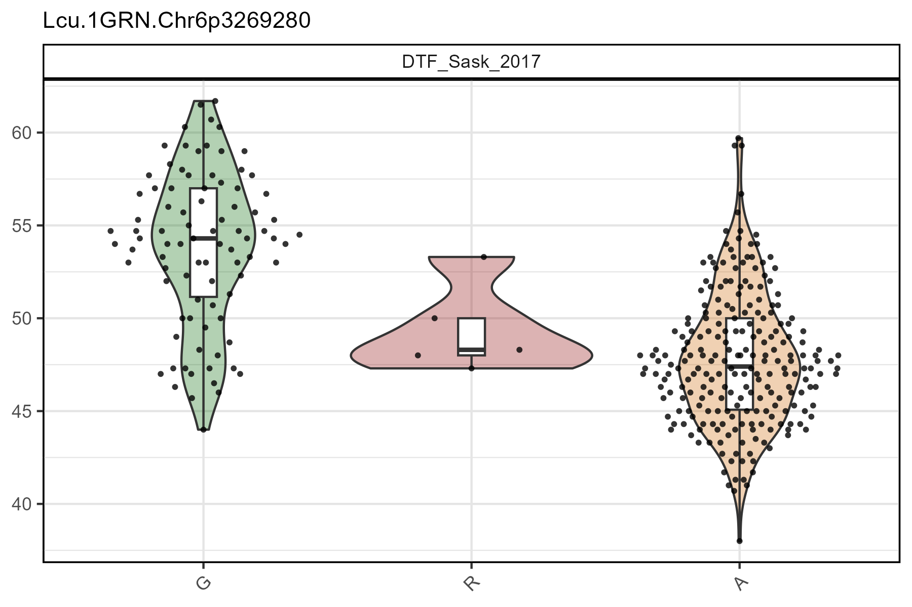
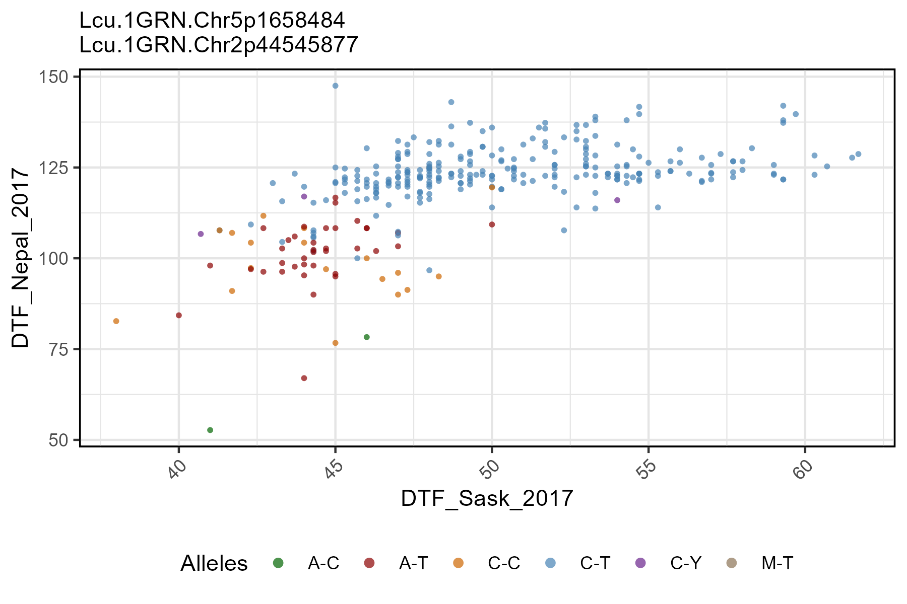

# gg_Marker_Scatter()

``` r

library(gwaspr)
```

The function
[`gg_Marker_Scatter()`](https://derekmichaelwright.github.io/gwaspr/reference/gg_Marker_Scatter.md)
creates marker plots with your `myY` and `myG` GWAS input files.

## Load data

> Note: `header = T`

``` r

# Load genotype file (note: header = T)
myG <- read.csv("gwaspr_myG_hmp.csv", header = T)
```

``` r

# Load phenotype file
myY <- read.csv("gwaspr_myY.csv")
```

------------------------------------------------------------------------

## Single marker, two traits

Specifying a `trait.x`, `trait.y`, and `markers` along with your
genotype and phenotype data as `xG` and `xY` is needed to create marker
plots.

``` r

# Plot
mp <- gg_Marker_Scatter(
  # Genotype data
  xG = myG, 
  # Phenotype data
  xY = myY,
  # Select traits to plot
  trait.x = "DTF_Sask_2017",
  trait.y = "DTF_Nepal_2017",
  # Select markers to plot
  markers = "Lcu.1GRN.Chr6p3269280" )
# Save
ggsave("figures/gg_Marker_Scatter_01.png", 
       mp, width = 6, height = 4 )
```


------------------------------------------------------------------------

## All options

[`gg_Marker_Bar()`](https://derekmichaelwright.github.io/gwaspr/reference/gg_Marker_Bar.md)
contains a number of different options for customizing the marker plots.

``` r

# Prep data
markers <- c("Lcu.1GRN.Chr6p3269280")
# Plot
mp <- gg_Marker_Scatter(
  xG = myG, 
  xY = myY,
  trait.x = "DTF_Sask_2017",
  trait.y = "DTF_Nepal_2017",
  markers = markers,
  marker.colors = gwaspr_Colors,
  remove.hets = F,
  point.size = 1,
  title = NULL,
  legend.rows = 1,
  subtitle = paste(markers, collapse = "\n") )
# Save
ggsave("figures/gg_Marker_Scatter_02.png", 
       mp, width = 6, height = 4 )
```



------------------------------------------------------------------------

## Multiple markers

``` r

# Plot
mp <- gg_Marker_Scatter(
  # Genotype data
  xG = myG, 
  # Phenotype data
  xY = myY,
  # Select traits to plot
  trait.x = "DTF_Sask_2017",
  trait.y = "DTF_Nepal_2017",
  # Select markers to plot
  markers = c("Lcu.1GRN.Chr5p1658484", "Lcu.1GRN.Chr2p44545877") )
# Save
ggsave("figures/gg_Marker_Scatter_03.png", 
       mp, width = 6, height = 4 )
```


