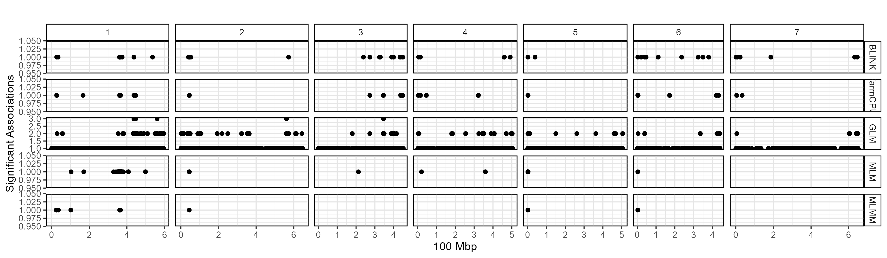

```{r setup, include = FALSE}
knitr::opts_chunk$set(echo = T, message = F, warning = F)
```

```{r echo = F}
library(gwaspr)
```

## gg_GWAS_Hits()

```{r eval = F}
# Plot
mp <- gg_GWAS_Hits(
  folder = "GWAS_Results/" )
# Save
ggsave("figures/gg_GWAS_Hits_01.png", mp, width = 12, height = 3.5)
```


