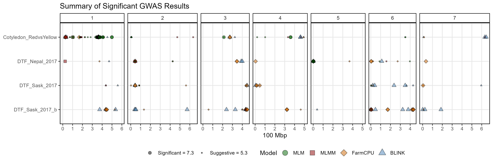
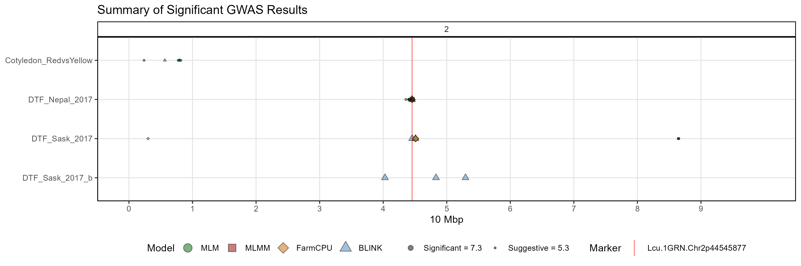

```{r setup, include = FALSE}
knitr::opts_chunk$set(message = F, warning = F)
```

```{r}
library(gwaspr)
```

The function `gg_GWAS_Summary()` creates summary plots showing significant association from your GWAS analyses. 

# Prepare GWAS results

Before using the function `gg_GWAS_Summary()`, in order to reduce the run time of the function, the GWAS results files need to be ordered based on p.values. this can be done with the function `order_GWAS_Results()` and confirmed with `is_Ordered()`

```{r eval = F}
order_GWAS_Results(folder = "GWAS_Results/")
is_Ordered(folder = "GWAS_Results/")
```

# Summarise all results

Specifying a `folder` is all that is needed to create summary GWAS plots.

```{r eval = F}
# Plot
mp <- gg_GWAS_Summary(
  # Specify a folder with GWAS results
  folder = "GWAS_Results/" )
# Save
ggsave("figures/gg_GWAS_Summary_01.png",
       mp, width = 12, height = 4 )
```


---

# Plotly

Make it an interactive plot with the following code

```{r eval = F}
gg_plotly(mp, filename = "figures/gg_GWAS_Summary_01.html")
```

https://derekmichaelwright.github.io/gwaspr/vignettes/figures/gg_GWAS_Summary_01.html

---

# All options

```{r eval = F}
folder <- "GWAS_Results/"
# Plot
mp <- gg_GWAS_Summary(
  folder = folder,
  traits = list_Traits(folder),
  groups = NULL,
  threshold = round(-log10(0.00000005),1),
  sug.threshold = round(-log10(0.000005),1),
  chr = NULL, pos1 = NULL, pos2 = NULL,
  models =  c("MLM", "MLMM", "FarmCPU", "BLINK", "CMLM", "SUPER"),
  model.colors = gwaspr_Colors,
  shapes = 21:25,
  hlines = NULL,
  vlines = NULL,
  vline.colors = rep("red",length(vlines)),
  vline.types = rep(1, length(vlines)),
  vline.legend = T,
  threshold.legend = T,
  title = "Summary of Significant GWAS Results",
  caption = NULL,
  rowread = 2000,
  legend.position = "bottom",
  legend.rows = 1,
  chr.unit = "100 Mbp",
  plotHBPvalues = F,
  skyline = "NYC" )
# Save
ggsave("figures/gg_GWAS_Summary_02.png", 
       mp, width = 12, height = 4 )
```



---

# Zoomed-in plot

```{r eval = F}
# Plot
mp <- gg_GWAS_Summary(
  # Specify a folder with GWAS results
  folder = "GWAS_Results/",
  # Set vertical lines
  vlines = "Lcu.1GRN.Chr2p44545877",
  # Choose area to zoom-in on
  chr = 2, pos1 = 0, pos2 = 100000000, chr.unit = "10 Mbp")
# Save
ggsave("figures/gg_GWAS_Summary_03.png", 
       mp, width = 12, height = 4 )
```



---

# Facet grouping

The option `groups` can be used to facet the traits. The requirement is that the list of for `groups` must be equal in length with `traits`

```{r eval = F}
# Prep data
traits <- c("Cotyledon_RedvsYellow","DTF_Nepal_2017", "DTF_Sask_2017", "DTF_Sask_2017_b")
groups <- c("Seed", "DTF", "DTF", "DTF")
# Plot
mp <- gg_GWAS_Summary(
  # Specify a folder with GWAS results
  folder = "GWAS_Results/",
  # Select traits to plot
  traits <- traits,
  # Set groups for facetting
  groups = groups )
# Save
ggsave("figures/gg_GWAS_Summary_04.png", 
       mp, width = 12, height = 4 )
```


