```{r setup, include = FALSE}
knitr::opts_chunk$set(message = F, warning = F)
```

```{r}
library(gwaspr)
```

# Single Trait

The function `gg_Manhattan()` creates manhattan plots from GAPIT GWAS results. 

Specifying a `folder` and `trait` is all that is needed to create manhattan plots.

```{r eval = F}
# Plot
mp <- gg_Manhattan(
  # Specify a folder with GWAS results
  folder = "GWAS_Results/", 
  # Select a trait to plot
  traits = "DTF_Nepal_2017" )
# Save
ggsave("figures/gg_Manhattan_01_DTF_Nepal_2017.png", 
       mp, width = 12, height = 3.5, bg = "white" )
```

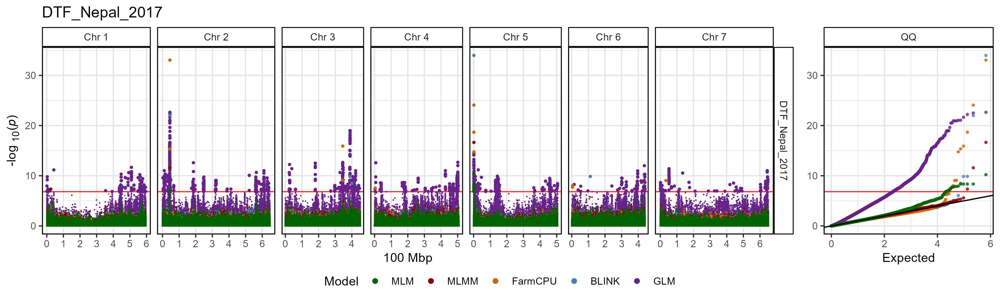

---

# Plot all traits with a loop

A simple loop can be used to plot GWAS results for each trait within the specified `folder`. 

```{r eval = F}
# Create for loop
for(i in list_Traits(folder = "GWAS_Results/")) {
  # Plot
  mp <- gg_Manhattan(
    # Specify a folder with GWAS results
    folder = "GWAS_Results/", 
    # Select a trait to plot
    traits = i )
  # Save
  ggsave(paste0("figures/gg_Manhattan_01_", i, ".png"), 
         mp, width = 12, height = 3.5, bg = "white" )
}
```


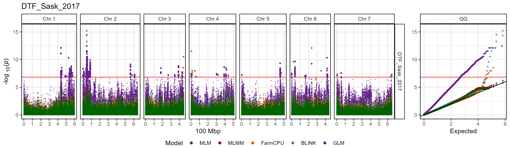

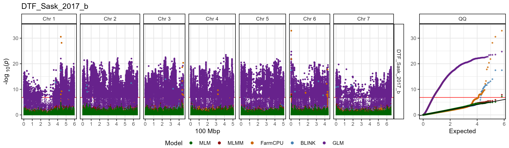

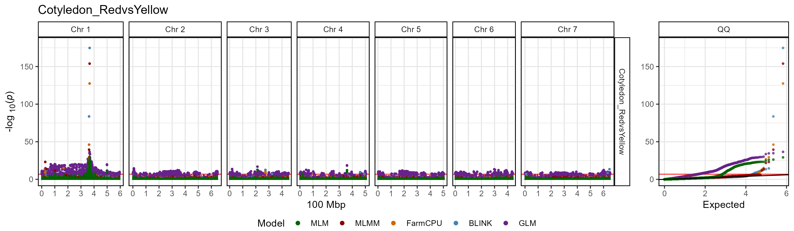

---

# All options

```{r eval = F}
# Prep data
traits <- "DTF_Nepal_2017"
markers <- c("Lcu.1GRN.Chr2p44545877", "Lcu.1GRN.Chr5p1658484")
vlines <- markers
# Plot
mp <- gg_Manhattan(
  folder = "GWAS_Results/",
    traits = traits,
    title = paste(traits, collapse = " "),
    threshold = NULL,
    sug.threshold = NULL,
    chr = NULL,
    markers = markers,
    labels = markers,
    vlines = markers,
    vline.colors = rep("red", length(vlines)),
    vline.types = rep(1, length(vlines)),
    legend = T,
    legend.rows = 1,
    legend.box = "horizontal",
    point.sizes = c(0.3,1,0.75),
    pmax = NULL,
    pmin = 0,
    models =  c("MLM", "MLMM", "FarmCPU", "BLINK", "GLM", "CMLM", "SUPER"),
    model.colors = c("darkgreen", "darkred", "darkorange3", "steelblue", 
                     "darkorchid4", "blue2", "magenta3"),
    trait.colors = gwaspr_Colors,
    facet.model = F,
    highlight.sig = F,
    sig.color = "black",
    chr.unit = "100 Mbp",
    plotHBPvalues = F,
    skyline = "NYC",
    addQQ = T )
# Save
ggsave("figures/gg_Manhattan_01_1.png", 
       mp, width = 12, height = 3.5, bg = "white" )
```

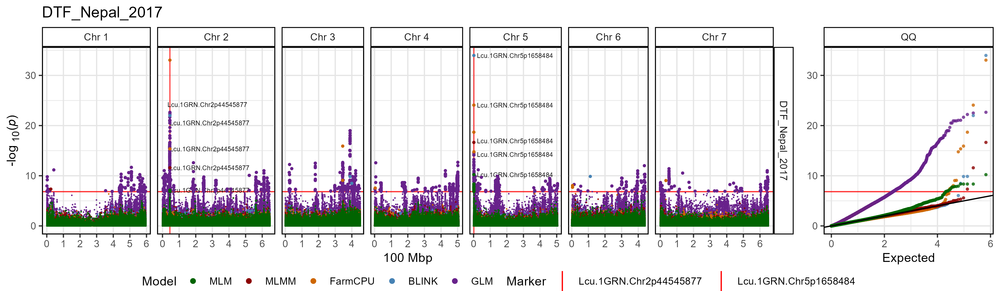

---

# Multiple traits

```{r eval = F}
# Plot
mp <- gg_Manhattan(
  # Specify a folder with GWAS results
  folder = "GWAS_Results/",
  # Select traits to plot
  traits = c("DTF_Nepal_2017", "DTF_Sask_2017", "DTF_Sask_2017_b"),
  # Specify GWAS models to plot
  models =  c("MLM", "MLMM", "FarmCPU", "BLINK") )
# Save
ggsave("figures/gg_Manhattan_02_1.png", 
       mp, width = 12, height = 8, bg = "white" )
```

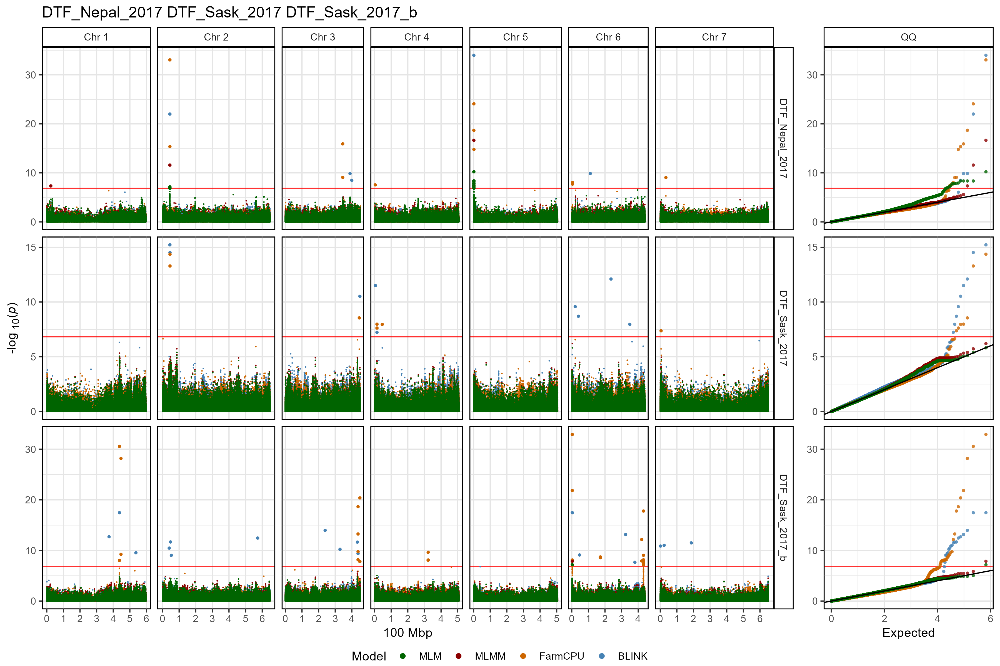

---

## Customized plot

```{r eval = F}
# Plot
mp <- gg_Manhattan(
  # Specify a folder with GWAS results
  folder = "GWAS_Results/",
  # Select traits to plot
  traits = c("DTF_Nepal_2017", "DTF_Sask_2017", "DTF_Sask_2017_b"),
  # Specify a title
  title = "Days to Flower",
  # Highlight specific markers
  markers = c("Lcu.1GRN.Chr2p44545877",
              "Lcu.1GRN.Chr5p1658484",
              "Lcu.1GRN.Chr6p3269280" ),
  # Create alt labels for the markers
  labels = c("44Mbp", "16Mbp", "32Mbp"),
  # Specify Color for each marker vline
  vline.colors = c("red", "red", "blue"),
  vline.types = c(2, 2, 1),
  # Change the legend alignment
  legend.box="vertical",
  # Specify GWAS models to plot
  models =  c("MLM", "MLMM", "FarmCPU", "BLINK") )
# Save
ggsave("figures/gg_Manhattan_02_2.png", 
       mp, width = 12, height = 8, bg = "white" )
```


---

# Facet by Model

The default setting for `gg_Manhattan()` is to set `facet.model = F` which will plot all models together and facet by trait if multiple traits are selected. By changing `facet.model = T` we can separate each GWAS model. When setting `facet.model = T`, points are now colored by trait, which can be changed with `trait.colors`. Significant associations can also be highlighted by setting `highlight.sig` and `sig.color`.

```{r eval = F}
# Plot
mp <- gg_Manhattan(
  # Specify a folder with GWAS results
  folder = "GWAS_Results/",
  # Select a trait to plot
  traits = "Cotyledon_RedvsYellow", 
  # Facet out the different GWAS models
  facet.model = T,
  # Set chromosome colors
  trait.colors = gwaspr_Colors )
# Save
ggsave("figures/gg_Manhattan_03_1.png", 
       mp, width = 12, height = 8, bg = "white" )
```

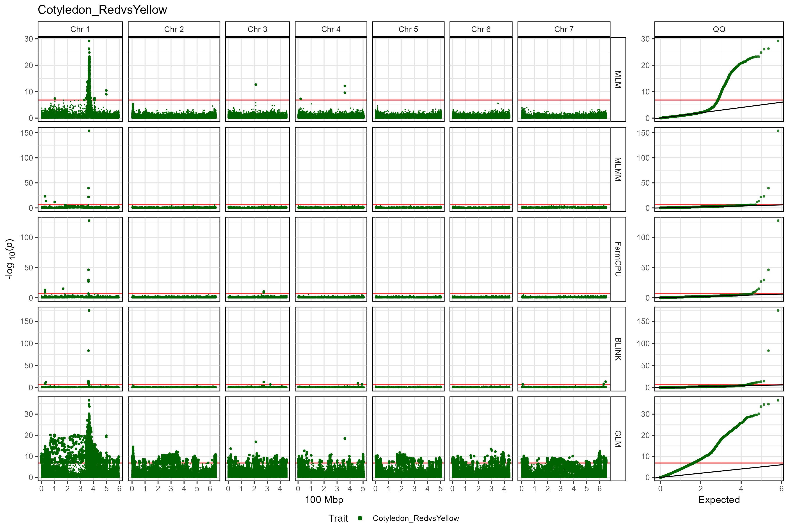

---

## Multiple traits

```{r eval = F}
# Plot
mp <- gg_Manhattan(
  # Specify a folder with GWAS results
  folder = "GWAS_Results/",
  # Select traits to plot
  traits = c("DTF_Nepal_2017", "DTF_Sask_2017", "DTF_Sask_2017_b"),
  # Facet out the different GWAS models
  facet.model = T )
# Save
ggsave("figures/gg_Manhattan_03_2.png", 
       mp, width = 12, height = 8, bg = "white" )
```

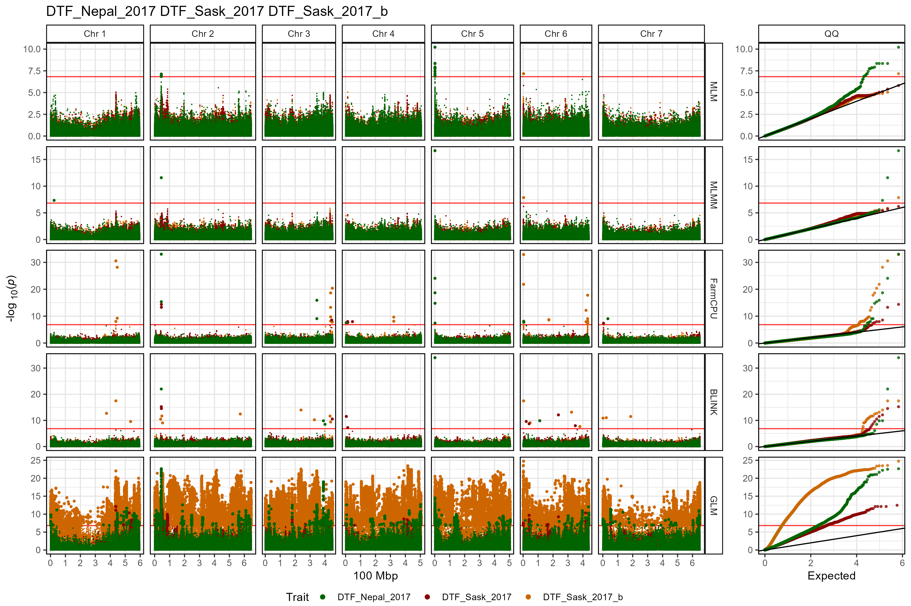

---

## Customized plot

```{r eval = F}
# Plot
mp <- gg_Manhattan(
  # Specify a folder with GWAS results
  folder = "GWAS_Results/",
  # Select traits to plot
  traits = c("DTF_Nepal_2017", "DTF_Sask_2017", "DTF_Sask_2017_b"),
  # Specify a title
  title = "Days to Flower",
  # Add vertical lines
  vlines = c("Lcu.1GRN.Chr2p44545877",
              "Lcu.1GRN.Chr5p1658484",
              "Lcu.1GRN.Chr6p3269280" ),
  vline.colors = c("red", "red", "blue"),
  vline.types = c(2, 2, 1),
  # Change the legend alignment
  legend.box="vertical",
  # Choose a GWAS model
  models =  c("MLM","MLMM","FarmCPU","BLINK"),
  # Facet out the different GWAS models
  facet.model = T )
# Save
ggsave("figures/gg_Manhattan_03_3.png", 
       mp, width = 12, height = 8, bg = "white" )
```

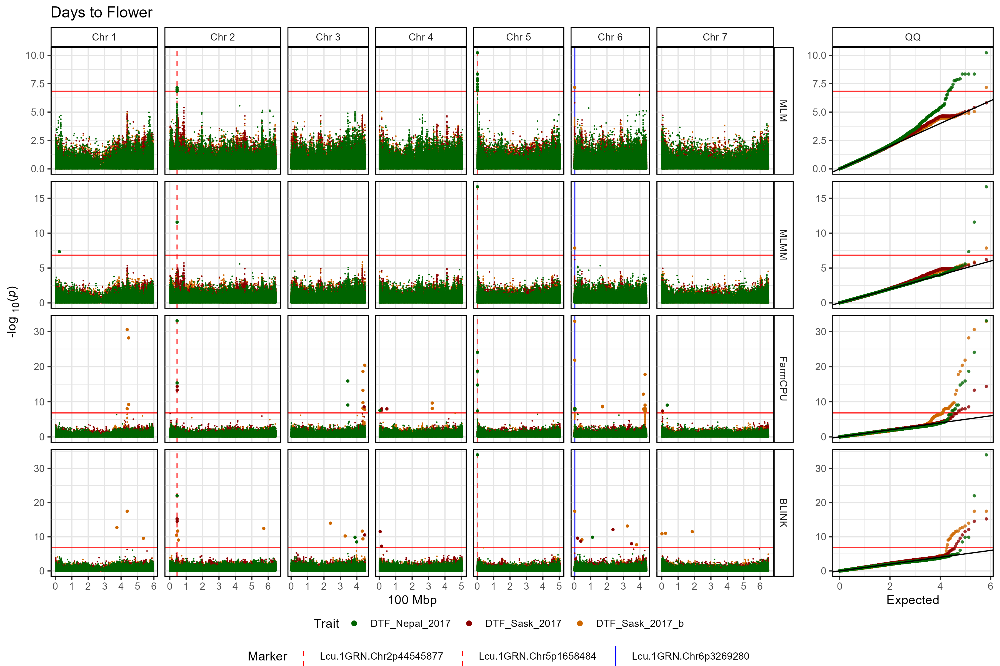

---

## Single model, multiple traits

```{r eval = F}
# Plot
mp <- gg_Manhattan(
  # Specify a folder with GWAS results
  folder = "GWAS_Results/",
  # Select traits to plot
  traits = c("DTF_Nepal_2017", "DTF_Sask_2017", "DTF_Sask_2017_b"),
  # Specify a title
  title = "Days to Flower",
  # Set horizontal thresholds bars
  threshold = 6.7,
  sug.threshold = 5,
  # Add vertical lines
  vlines = c("Lcu.1GRN.Chr2p44545877",
              "Lcu.1GRN.Chr5p1658484",
              "Lcu.1GRN.Chr6p3269280" ),
  vline.colors = c("red", "red", "blue"),
  vline.types = c(2, 2, 1),
  # Change the legend alignment
  legend.box="vertical",
  # Choose a GWAS model
  models =  "MLM",
  # Facet out the different GWAS models
  facet.model = T )
# Save
ggsave("figures/gg_Manhattan_03_4.png", 
       mp, width = 12, height = 3.5, bg = "white" )
```

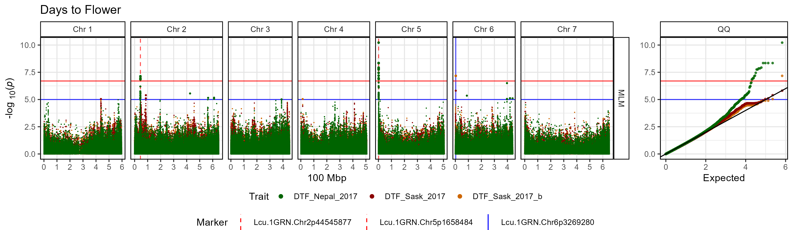

---

# Single Chromosome

A single chromosome can be plotted by setting `chr`. The x-axis can also be adjusted by setting `chr.unit`.

```{r eval = F}
# Plot
mp <- gg_Manhattan(
  # Specify a folder with GWAS results
  folder = "GWAS_Results/", 
  # Select a trait to plot
  traits = "DTF_Nepal_2017",
  # Select a chromosome to plot
  chr = 2 )
# Save
ggsave("figures/gg_Manhattan_04_1.png", 
       mp, width = 7, height = 3.5, bg = "white" )
```

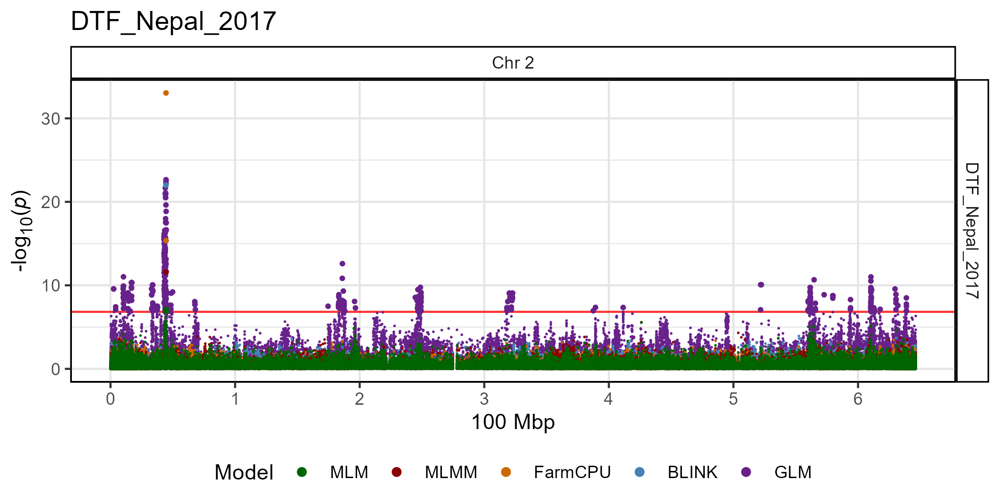

---

# Customized plots

The default for `gg_Manhattan()` is to set the plot `title = paste(traits, collapse = " ")`, but this can be changed. You can also adjust the `threshold` and add a`sug.threshold`. If specified, `markers` can be highlighted and have their `labels` customized. Adding `vlines` can be used to aid in comparisons with other manhattan plots or accross GWAS `models`. `vlines` can be customized with `vline.colors` and `vline.types`. You can Select which GWAS `models` to plot and set the colors of each with `model.colors`. Significant associations can also be highlighted by setting `highlight.sig` and `sig.color`. The QQ plot can also be removed by setting `addQQ = F`.

## DTF Nepal 2017 

```{r eval = F}
# Plot
mp <- gg_Manhattan(
  # Specify a folder with GWAS results
  folder = "GWAS_Results/",
  # Select a trait to plot
  traits = "DTF_Nepal_2017",
  # Create a title for the plot
  title = "DTF Nepal 2017",
  # Set horizontal thresholds bars
  threshold = 6.7,
  sug.threshold = 5,
  # Highlight specific markers
  markers = c("Lcu.1GRN.Chr2p44545877",
              "Lcu.1GRN.Chr5p1658484"),
  labels = c("M1", "M2"),
  # Add vertical lines
  vlines = c("Lcu.1GRN.Chr2p44545877",
             "Lcu.1GRN.Chr5p1658484",
             "Lcu.1GRN.Chr6p3269280" ),
  vline.colors = c("red", "red", "blue"),
  vline.types = c(1, 1, 2),
  # Change the legend alignment
  legend.box = "vertical",
  # Select GWAS models
  models = c("MLM", "MLMM", "FarmCPU", "BLINK"),
  # Set colors for each GWAS model
  model.colors = c("darkgreen", "darkred", "darkorange3", "steelblue"),
  # Highlight significant associations
  highlight.sig = T,
  # Highlight color
  sig.color = "black",
  # Remove the QQ plot
  addQQ = F )
# Save
ggsave("figures/gg_Manhattan_05_1.png", 
       mp, width = 8, height = 3.5, bg = "white" )
```

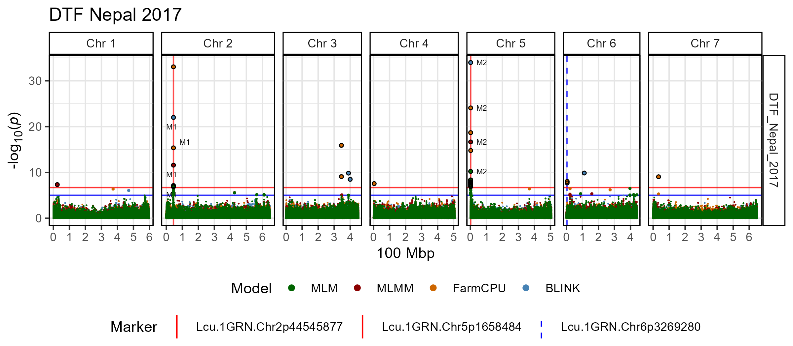

---

## DTF Sask 2017 | Covariate = b

```{r eval = F}
# Plot
mp <- gg_Manhattan(
  # Specify a folder with GWAS results
  folder = "GWAS_Results/",
  # Select a trait to plot
  traits = "DTF_Sask_2017_b",
  # Create a title for the plot
  title = "DTF Sask 2017 | Covariate = b",
  # Set horizontal thresholds bars
  threshold = 6.7,
  sug.threshold = 5,
  # Highlight specific markers
  markers = "Lcu.1GRN.Chr6p3269280",
  labels = "p3269280",
  # Add vertical lines
  vlines = c("Lcu.1GRN.Chr2p44545877",
             "Lcu.1GRN.Chr5p1658484",
             "Lcu.1GRN.Chr6p3269280" ),
  vline.colors = c("red", "red", "blue"),
  vline.types = c(2, 2, 1),
  # Change the legend alignment
  legend.box = "vertical",
  # Select GWAS models
  models = c("MLM", "MLMM", "FarmCPU", "BLINK"),
  # Set colors for each GWAS model
  model.colors = c("darkgreen", "darkred", "darkorange3", "steelblue"),
  # Highlight significant associations
  highlight.sig = T,
  # Highlight color
  sig.color = "black",
  # Remove the QQ plot
  addQQ = F )
# Save
ggsave("figures/gg_Manhattan_05_2.png", 
       mp, width = 8, height = 3.5, bg = "white" )
```

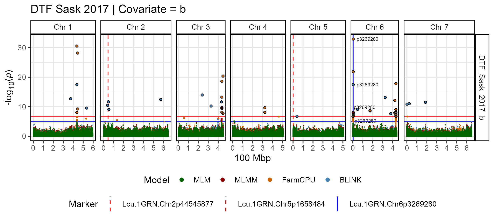
