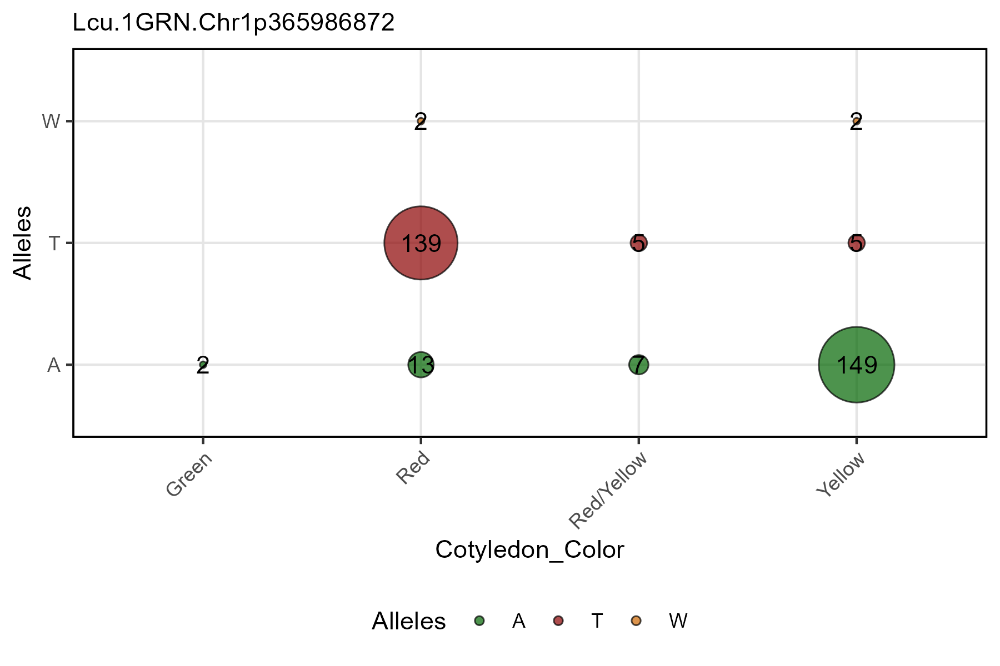
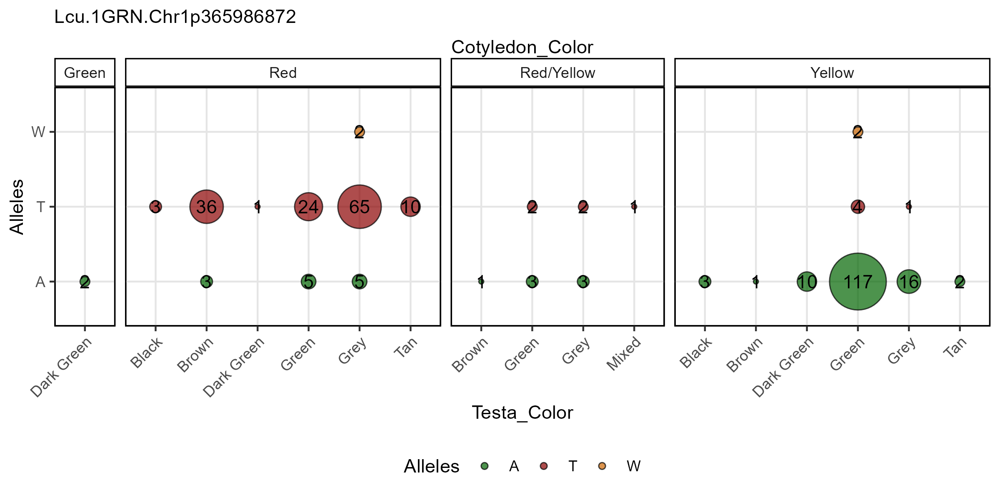
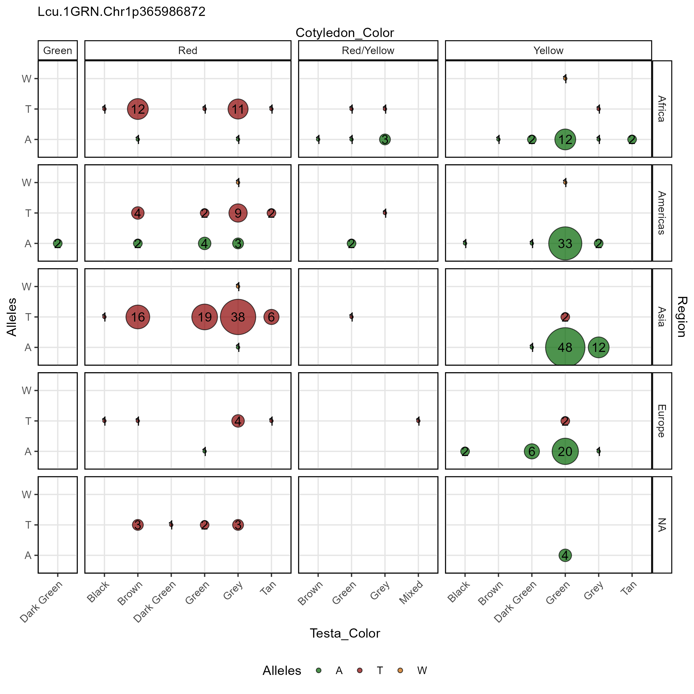

```{r setup, include = FALSE}
knitr::opts_chunk$set(message = F, warning = F)
```

```{r}
library(gwaspr)
```

The function `gg_Marker_Bubble()` creates marker plots with your `myY` and `myG` GWAS input files.

# Load data

> Note: `header = T`

```{r eval = F}
# Load genotype file (note: header = T)
myG <- read.csv("Data/gwaspr_myG_hmp.csv", header = T)
```

```{r eval = F}
# Load phenotype file
myY <- read.csv("Data/gwaspr_myY.csv")
```

---

# Single marker, single trait

Specifying a `trait.x` or `trait.y` and `markers` along with your genotype and phenotype data as `xG` and `xY` is needed to create marker plots.

> Note: one of `trait.x`, `trait.y`, `facet.rows`, `facet.cols` must be set to `= "Alleles"`

```{r eval = F}
# Plot
mp <- gg_Marker_Bubble(
  # Genotype data
  xG = myG, 
  # Phenotype data
  xY = myY,
  # Select traits to plot
  trait.x = "Cotyledon_Color",
  trait.y = "Alleles",
  # Select markers to plot
  markers = "Lcu.1GRN.Chr1p365986872" )
# Save
ggsave("figures/gg_Marker_Bubble_01.png", 
       mp, width = 6, height = 4 )
```


---

# All options

`gg_Marker_Bubbles()` contains a number of different options for customizing the marker plots.

Note: one of `trait.x`, `trait.y`, `facet.rows`, `facet.cols` must be set to `= "Alleles"`. 

```{r eval = F}
# Prep data
markers <- c("Lcu.1GRN.Chr1p365986872")
# Plot
mp <- gg_Marker_Bubble(
  xG = myG, 
  xY = myY,
  trait.x = "Cotyledon_Color",
  markers = markers,
  trait.y = "Alleles",
  facet.rows = NULL,
  facet.cols = NULL,
  marker.colors = gwaspr_Colors,
  remove.hets = F,
  remove.N = T,
  legend.pos = "bottom",
  legend.rows = 1,
  title = NULL,
  subtitle = paste(markers, collapse = "\n") )
# Save
ggsave("figures/gg_Marker_Bubble_02.png", 
       mp, width = 6, height = 4 )
```



---

# Facet grouping

## Column facetting

```{r eval = F}
# Plot
mp <- gg_Marker_Bubble(
  # Genotype data
  xG = myG, 
  # Phenotype data
  xY = myY,
  # Select traits to plot
  trait.x = "Testa_Color",
  trait.y = "Alleles",
  # Select markers to plot
  markers = "Lcu.1GRN.Chr1p365986872",
  # Select a trait for col facetting
  facet.cols = "Cotyledon_Color" )
# Save
ggsave("figures/gg_Marker_Bubble_03.png", 
       mp, width = 8, height = 4 )
```



---

## Row facetting

```{r eval = F}
# Plot
mp <- gg_Marker_Bubble(
  # Genotype data
  xG = myG, 
  # Phenotype data
  xY = myY,
  # Select traits to plot
  trait.x = "Testa_Color",
  trait.y = "Alleles",
  # Select markers to plot
  markers = "Lcu.1GRN.Chr1p365986872",
  # Select a trait for col facetting
  facet.cols = "Cotyledon_Color",
  # Select a trait for row facetting
  facet.rows = "Region" )
# Save
ggsave("figures/gg_Marker_Bubble_04.png", 
       mp, width = 8, height = 8 )
```


